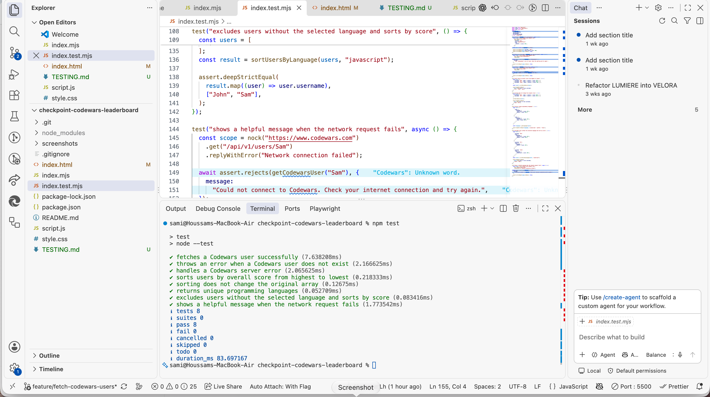
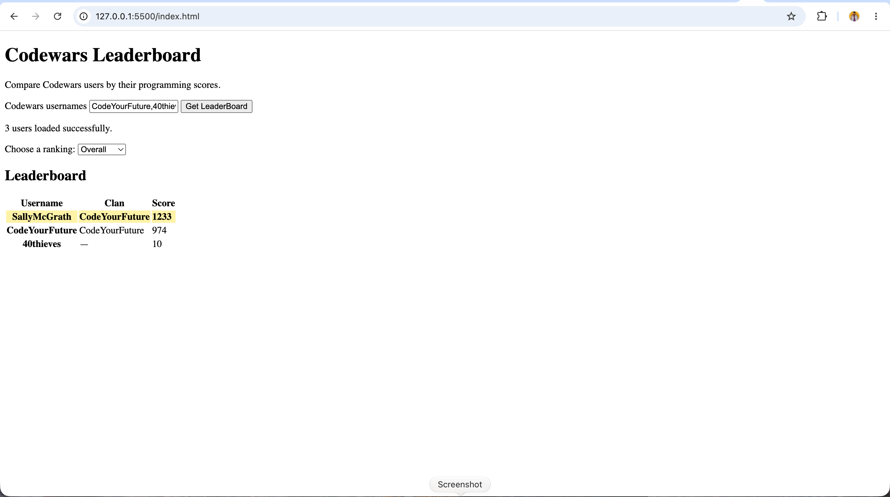
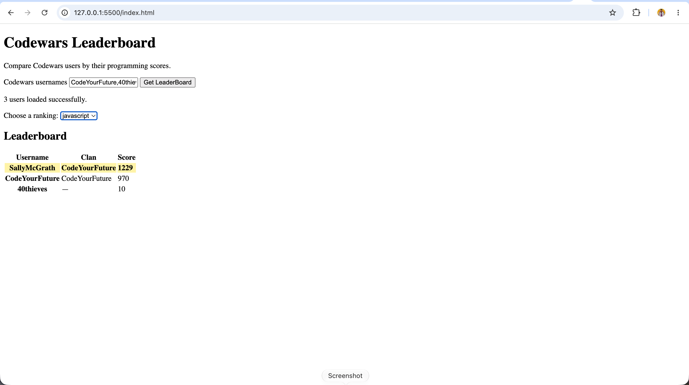
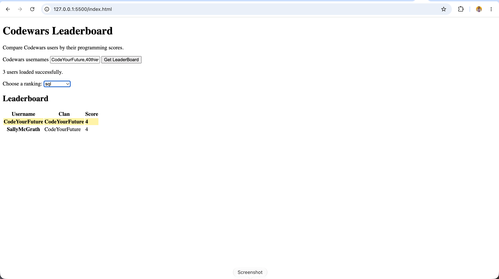
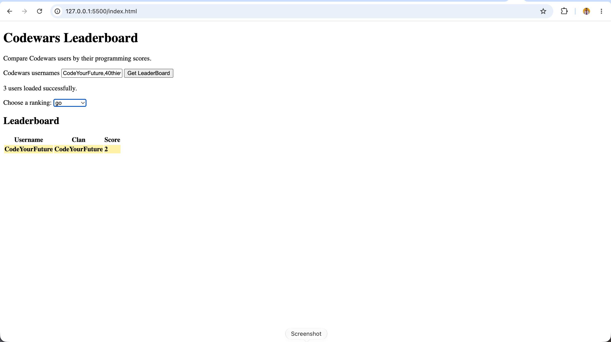
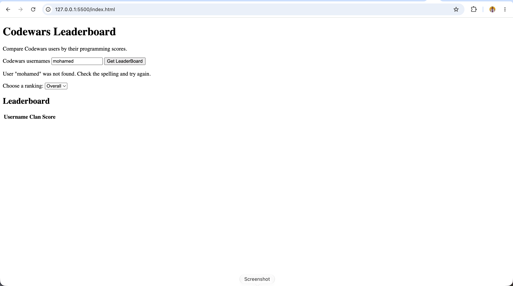
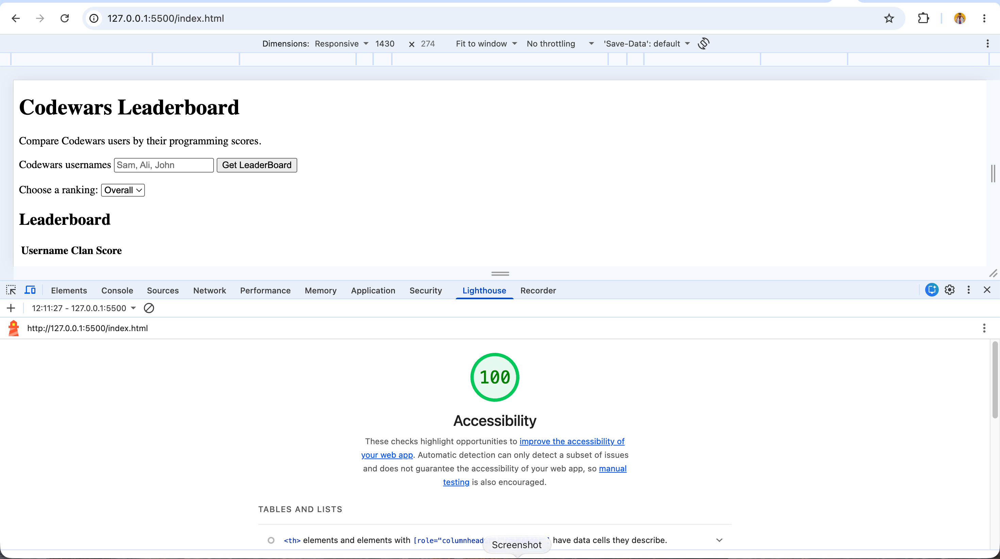
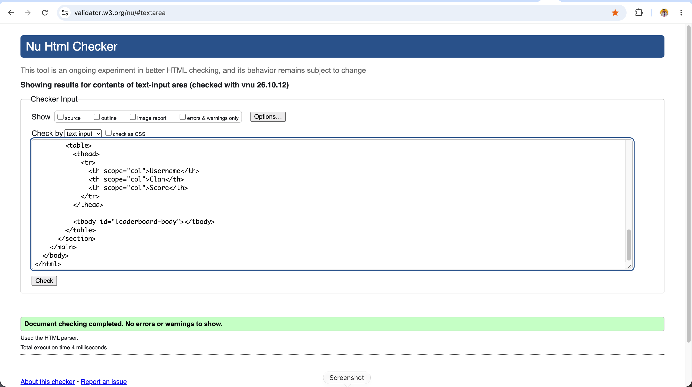

# Codewars Leaderboard — Testing Evidence

## 1. Automated Unit Tests

**Command:** `npm test`

**Result:** 8 tests passed, 0 failed.

The tests verify:

- Successful fetching of Codewars user data.
- Error handling for usernames that do not exist (HTTP 404).
- Error handling for server failures (HTTP 500).
- Sorting users by overall score.
- Sorting without modifying the original array.
- Collecting unique programming languages.
- Excluding users without the selected language and sorting the remaining users.
- Displaying a helpful error message when a network request fails.

API requests are mocked using `nock`.

## 2. Manual Testing Evidence

### 2.1 Overall leaderboard

**Result:** PASS

Three Codewars users displayed and sorted by overall score, with the highest-ranked user highlighted.

### 2.2 JavaScript ranking

**Result:** PASS

The leaderboard displays scores for JavaScript instead of overall scores.

### 2.3 SQL ranking — Missing users excluded

**Result:** PASS

Only CodeYourFuture and SallyMcGrath have SQL rankings in this test.

### 2.4 Go ranking — Missing users excluded

**Result:** PASS

Only CodeYourFuture appears for the selected Go ranking.

### 2.5 Invalid username

**Result:** PASS

The application displays a helpful error instead of showing incorrect results.

### 2.6 Loading state

**Result:** PASS

The application displays a loading message and disables the submit button.

[Watch the loading-state test]

https://github.com/user-attachments/assets/48ecb697-4759-4db9-94b5-4c637a6368c5

### 2.7 Repeated Searches and Error Recovery

**Result:** PASS

Manual testing confirmed that:

- A new search clears the previous leaderboard.
- The ranking dropdown resets to Overall.
- Old language options are replaced with the new users' languages.
- The submit button becomes enabled after loading.
- A valid search succeeds after an invalid username error.

## 3. Accessibility and HTML Validation

### 3.1 Lighthouse Accessibility — Initial Page

**Tool:** Google Chrome Lighthouse

**Device:** Desktop

**Category:** Accessibility

**Result:** PASS — 100/100

### 3.2 Lighthouse Snapshot — Dynamic Page States

**Tool:** Google Chrome Lighthouse

**Mode:** Snapshot

**Device:** Desktop

**Category:** Accessibility

**Result:** PASS — All tested states achieved 100/100.

| Page state | Accessibility score |
|---|---|
| Initial page | 100/100 |
| Overall leaderboard with three users | 100/100 |
| JavaScript ranking selected | 100/100 |
| Invalid username error | 100/100 |

#### Overall Leaderboard

The leaderboard was populated with three Codewars users before running the accessibility audit.

[Watch the Overall leaderboard accessibility test]

https://github.com/user-attachments/assets/cacccee6-2796-4006-b085-6590b3dbcfb0

#### JavaScript Ranking

The JavaScript ranking was selected before running the accessibility audit.

[Watch the JavaScript ranking accessibility test]

https://github.com/user-attachments/assets/7a0788c5-c291-441b-b81c-dcfaf82f4aa6

#### Invalid Username Error

An invalid username was submitted before running the accessibility audit.

[Watch the error-state accessibility test]

https://github.com/user-attachments/assets/2864cd32-13dc-4f26-ae17-07e4937ce8ec

### 3.3 Lighthouse — Full Audit Report

The initial page was tested using Google Chrome Lighthouse on desktop.

| Category | Score |
|---|---|
| Performance | 100/100 |
| Accessibility | 100/100 |
| Best Practices | 100/100 |
| SEO | 100/100 |

[View the full Lighthouse PDF report](screenshots/accessibility-report-all-categories.pdf)

The full PDF report documents the initial page-load audit. The separate videos provide evidence of the dynamic Snapshot audits.

### 3.4 HTML Validation

**Tool:** W3C Nu HTML Checker

**Result:** PASS — No errors or warnings reported.

The application's HTML source was checked using the W3C Nu HTML Checker.

## 4. Conclusion

All 8 automated unit tests passed.

Manual browser testing confirmed that the application:

- Fetches real Codewars user data.
- Displays usernames, clans and scores.
- Sorts rankings from highest to lowest score.
- Supports overall and language-specific rankings.
- Excludes users without a selected language ranking.
- Highlights the top-ranked user.
- Displays useful messages during loading and after errors.
- Supports repeated searches.
